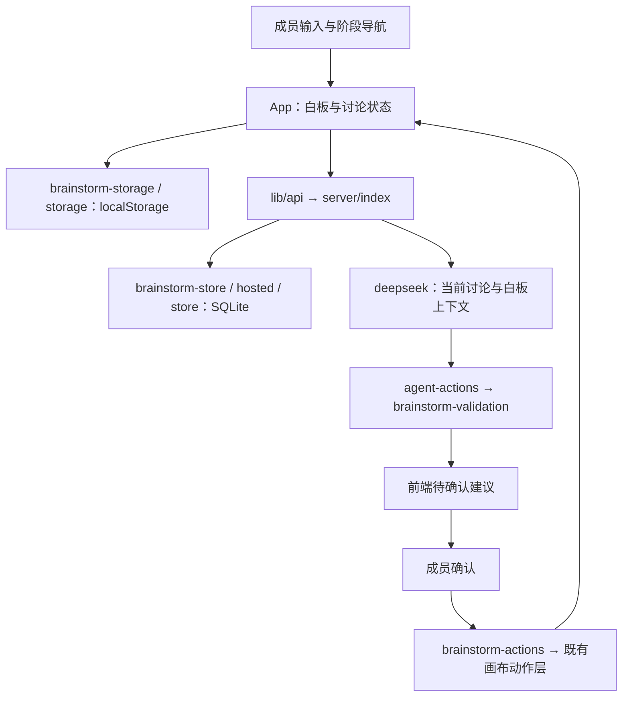

# AI-Mural 架构

## 模块职责

| 文件或模块 | 职责 |
| --- | --- |
| `src/main.tsx` | 挂载 React 应用并载入页面样式。 |
| `src/App.tsx` | 连接讨论状态、React Flow、统一动作层、历史、协作同步和建议请求。 |
| `src/types.ts` | 定义白板、讨论、成员、观点、建议、候选方案、决策、成果和记录的共享类型。 |
| `src/data.ts` | 提供空白白板的初始结构。 |
| `src/components/StageNavigator.tsx` | 显示七阶段导航并接受成员手动切换。 |
| `src/components/BrainstormPanel.tsx` | 显示讨论侧栏、AI 请求入口和建议处理状态。 |
| `src/components/MemberControls.tsx` | 添加成员昵称并切换当前操作成员。 |
| `src/components/SuggestionCard.tsx` | 显示与编辑建议，并提供接受、忽略和稍后操作。 |
| `src/components/ProposalEditor.tsx` | 编辑候选方案、来源观点、组合逻辑、风险和分类评论。 |
| `src/components/DecisionEditor.tsx` | 保存人工标准、权重、评分理由和投票，并生成白板比较矩阵。 |
| `src/components/OutcomeEditor.tsx` | 编辑成果草稿、选择最终方案、确认结果并控制成果导出。 |
| `src/components/BoardElement.tsx`、`ToolRail.tsx`、`Inspector.tsx` | 绘制节点并提供内容创建、编辑、作者和来源查看。 |
| `src/components/AgentPanel.tsx`、`CollaborationDock.tsx` | 展示公开记录、参与者、活动和协作状态。 |
| `src/components/ShareModal.tsx`、`BoardLibraryMenu.tsx` | 管理托管分享链接与本地白板切换。 |
| `src/components/ConfirmModal.tsx`、`LayerMenu.tsx` | 提供人工确认和节点图层操作。 |
| `src/lib/brainstorm.ts` | 创建讨论和观点元信息，更新阶段与建议状态并判断成果是否已确认。 |
| `src/lib/brainstorm-actions.ts` | 管理建议上下文、忽略与暂停，复用既有动作执行已接受建议并撤销其变化。 |
| `src/lib/brainstorm-validation.ts` | 严格校验讨论快照、六种动作的固定字段和真实观点归属。 |
| `src/lib/brainstorm-storage.ts` | 在同一个本地快照中保存白板和讨论，并在读取时验证所属关系。 |
| `src/lib/board.ts` | 提供节点、连线、分类、布局和图层的画布基础操作。 |
| `src/lib/board-validation.ts`、`artifacts.ts` | 验证白板及结构化内容的数据格式。 |
| `src/lib/storage.ts` | 管理 localStorage 白板库、当前白板和导入数据验证。 |
| `src/lib/api.ts` | 调用讨论、建议、托管白板和记录 API，并检查服务端回执。 |
| `src/lib/recording.ts` | 管理公开讨论记录、参与者、检查点和本地记录导出。 |
| `src/lib/webmcp.ts`、`compatibility.ts` | 注册浏览器 Agent 工具并检查浏览器支持情况。 |
| `server/index.ts` | 注册 Express 路由、执行访问检查并提供构建后的静态页面。 |
| `server/brainstorm-store.ts` | 读写独立讨论表并拒绝旧版本保存或跨白板覆盖。 |
| `server/agent-actions.ts` | 验证建议请求和响应结构，并复用共享动作校验。 |
| `server/deepseek.ts` | 从服务端环境读取配置，用原生 fetch 请求 DeepSeek，并逐层校验上游 JSON。 |
| `server/hosted.ts` | 管理托管白板、访问能力、邀请、协作合并和焦点租约。 |
| `server/store.ts`、`export.ts` | 保存原有讨论记录，并生成记录导出内容。 |
| `server/db.ts`、`schema.ts` | 初始化 SQLite 与 Drizzle 表结构并提供数据库连接。 |
| `public/artifact-spec.schema.json` | 提供结构化白板内容的 JSON Schema。 |
| `vite.config.ts` | 构建前端，并在开发时将 API 请求转发到本地服务端。 |
| `package.json` | 定义本地启动命令；服务端启动时自动读取项目根目录的 `.env`。 |
| `Dockerfile`、`deploy/docker-compose.host.yml` | 定义容器运行环境、服务端入口和持久化数据卷。 |
| `*.test.ts`、`*.test.tsx` | 验证领域、界面、存储、授权、建议和运行布局，测试样本只存在于这些文件中。 |

## 模块调用关系

| 流程 | 调用与数据关系 |
| --- | --- |
| 创建与人工编辑 | `App` 使用领域函数更新讨论，通过统一动作层修改画布，并把两者放入同一笔历史。 |
| 本地保存 | `brainstorm-storage` 先验证快照，再调用 `storage` 将白板与讨论一次性写入 localStorage。 |
| 服务端保存 | `api` 发送当前版本，`server/index` 验证内容和能力，`brainstorm-store` 拒绝旧写入后保存 JSON。 |
| 请求 AI | `App` 先同步当前真实内容，建议路由读取已保存讨论及当前托管白板，`deepseek` 请求模型后交给共享校验。 |
| 接受建议 | 前端再次验证上下文和动作，`brainstorm-actions` 调用 `createCluster`、`connectElements`、`addElement`、`createArtifact` 等已有操作，或更新成果草稿。 |
| 撤销建议 | 接受前后快照记录变化；撤销检查后续编辑冲突，再更新白板、讨论和普通撤销历史。 |
| 成果导出 | `OutcomeEditor` 使用 `isOutcomeConfirmed` 检查人工确认，原始白板 JSON 由已有白板导出入口处理。 |

## 数据与接口

白板的 `ideaMeta` 保存讨论 ID、作者 ID、类型、创建时间、来源观点 ID 和版本。候选方案保留来源观点与分类评论；决策保存成员评分理由和投票；成果保存草稿、最终方案及行动安排。建议另存阶段、状态、请求上下文和接受前后快照。

SQLite 的 `brainstorm_sessions` 表保存白板与讨论 JSON，原有 `murals` 和记录相关表继续使用。localStorage 的键名与数据库默认文件名保留现有值，以兼容已有数据。

| 接口 | 职责 |
| --- | --- |
| `GET /api/brainstorm/:id` | 读取讨论与白板快照。 |
| `PUT /api/brainstorm/:id` | 验证所属关系、访问能力和版本后保存讨论。 |
| `POST /api/brainstorm/:id/suggestions` | 接收 `{ purpose, ideaIds? }` 并只返回 `{ message, actions }`。 |
| `/api/murals` 相关接口 | 管理托管白板、分享、邀请和协作。 |
| `/api/sessions` 相关接口 | 保存、读取与导出公开讨论记录。 |

本地讨论不要求托管令牌；托管讨论沿用白板的 Bearer 访问能力。建议路由不写数据库，也不调用会清理焦点数据的托管读取函数。请求返回前再次核对能力和内容版本，过时回包明确失败。

## 关键决定

| 决定 | 原因 |
| --- | --- |
| 新讨论完全空白，所有成员与内容由人输入 | 让任意话题都能开始，避免示例内容冒充参与者意见。 |
| 七阶段由成员手动导航 | 讨论可以返回或跳转，已有观点和少数意见持续保留。 |
| AI 只提出六类结构化建议 | 把模型输出限制在成员可理解、可检查和可确认的动作内。 |
| 动作共用严格校验和既有画布操作 | 保存、模型返回和前端确认使用同一契约，避免两套执行逻辑产生差异。 |
| 所有模型调用与密钥只在服务端 | 浏览器不持有 DeepSeek Key，缺少配置或上游错误时明确失败。 |
| 本地服务端启动时自动读取 `.env` | 使开发命令与配置约定一致；部署和容器继续由运行环境安全传入变量。 |
| 白板和讨论共用历史及本地快照 | 防止画布已撤销而讨论状态未恢复，或保存只完成一半。 |
| 讨论使用独立 SQLite JSON 表 | 保留既有协作和记录存储，避免重建白板协议。 |
| 草稿生成保留人工最终选择与行动安排 | 接受 AI 建议不会代替成员确认结果。 |
| 记录使用参与者明确输入的身份 | 不把默认昵称或默认主持人当成真实成员。 |
| 容器必须携带服务端共享校验的完整源码依赖 | 服务端运行时调用 `brainstorm-validation → board-validation → artifacts`，仅复制类型或前端产物不足以启动。 |

## 当前收尾状态

Task 1 至 Task 7 已完成。Docker 运行依赖、默认成员、中文界面和本地 DeepSeek 环境加载均已核验；完整测试通过 305 项，构建通过，真实模型调用通过严格校验后返回建议。
