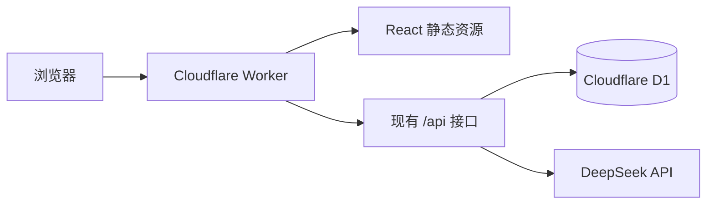

# Cloudflare Workers 与 D1 迁移设计

## 目标与边界

将 AI-Mural 从“浏览器静态页面 + Express + 本机 SQLite”迁移为单个 Cloudflare Worker：它同时提供 React 页面和现有全部 `/api` 接口，D1 持久保存协作数据。用户看到的界面、分享链接格式、权限能力令牌和 DeepSeek 建议流程均保持不变。

本次迁移必须导入当前本机 SQLite 中已有的 2 条 `brainstorm_sessions` 记录，且不删除或覆盖原始数据库。当前数据库中的其余六张业务表均为空，但 D1 仍须建立完整表结构，保证现有全部功能可继续使用。

不做账户登录、实时 WebSocket、多实例冲突合并、界面改版或模型替换。DeepSeek 的计费和账户仍由用户自己的 DeepSeek 账户负责。

## 可选方案

| 方案 | 结果 | 结论 |
| --- | --- | --- |
| 保留腾讯云 Docker | 代码几乎不用动，但需要服务器与长期费用 | 不采用 |
| Cloudflare Pages + 独立 API Worker | 能运行，但前端与 API 需要两套部署和跨域配置 | 不采用 |
| 单个 Worker + D1 | 一个公开地址、同源 API、数据持久化、可用免费额度 | 采用 |

Cloudflare 的 Vite 插件可在同一项目中构建 React 静态资源和 Worker API；D1 通过 Worker 绑定提供预处理 SQL 与原子批处理，适合保留本项目的 SQLite 数据模型。参考：[Vite 插件教程](https://developers.cloudflare.com/workers/vite-plugin/tutorial/)、[D1 Worker API](https://developers.cloudflare.com/d1/worker-api/d1-database/)。

## 目标结构

Worker 优先处理 `/api`；其余导航请求返回 React 应用，使原有前端继续相对路径访问 `/api`。数据层从全局本地数据库改为每个请求使用 `env.DB` 的 D1 绑定，不能保留 `better-sqlite3`、文件路径、Express、Node 监听端口或运行时建表逻辑。

## 模块与数据设计

| 部分 | 迁移后职责 |
| --- | --- |
| `worker/index.ts` | 接收 Fetch 请求、解析 JSON/路径/查询参数、匹配现有 16 个接口、返回 API 错误或静态资源。 |
| `worker/env.ts` | 定义 `DB`、DeepSeek 密钥、模型和可选基础地址的 Worker 环境类型。 |
| `worker/storage/*.ts` | 接收 D1 数据库对象，保存和读取讨论、托管白板、邀请、焦点和记录；不读取全局变量。 |
| `migrations/0001_initial_schema.sql` | 一次建立七张业务表及索引；以后只追加新的版本化迁移。 |
| `scripts/export-local-sqlite-data.*` | 仅用于上线前把本机数据库安全导出为可导入 D1 的 SQL；不在生产 Worker 中运行。 |
| `wrangler.jsonc`、`vite.config.ts` | 声明 Worker、D1 绑定、Vite Cloudflare 插件和 SPA 静态资源路由。 |

现有 Drizzle 的 SQLite 表定义继续描述表字段；其数据库驱动改为 D1。每次涉及多个表的保存使用 `D1Database.batch()`，由 D1 在一个批次内依序执行、出错即回滚，确保会话、成员和事件不出现半次保存。[D1 批处理说明](https://developers.cloudflare.com/d1/worker-api/d1-database/#batch)

`hosted.ts` 中所有 Node 加密实现改为 Worker Web Crypto：随机令牌用 `crypto.getRandomValues`，哈希用 `crypto.subtle.digest`，比较按字节完整遍历。令牌不会被写入响应日志或前端代码。

## 接口与安全

接口路径、请求体、成功状态码与错误含义保持不变：健康检查、讨论读写与建议、托管白板和邀请、焦点锁、记录读写删除和三种导出均必须继续可用。前端 `src/lib/api.ts` 不改为绝对地址，所有调用保持同源。

`DEEPSEEK_API_KEY` 只保存为 Cloudflare Worker secret，`DEEPSEEK_MODEL` 和可选 `DEEPSEEK_BASE_URL` 为 Worker 环境变量。本地开发使用未提交的 `.dev.vars`；没有密钥、模型或非法模型名称时仍明确报错，不使用默认密钥或默认模型。Cloudflare 通过 `wrangler secret put` 或控制台保存 Worker 密钥。[密钥配置](https://developers.cloudflare.com/workers/configuration/secrets/)

## 数据迁移与发布顺序

1. 复制当前 SQLite 数据库为只读备份，并保留 WAL/SHM 一起校验；原文件不删除、不改写。
2. 创建 D1 数据库，写入实际 `database_id`，部署空 Worker 前执行 `0001_initial_schema.sql`。
3. 从备份生成仅含数据的 SQL，移除 SQLite 事务包装，不在导入中创建表；用 Wrangler 导入 D1。
4. 在 D1 执行计数校验：`brainstorm_sessions` 必须为 2，其余当前为空的业务表为 0；抽样读取两条讨论并通过现有领域校验。
5. 上传 DeepSeek 密钥与配置后部署 Worker；检查 `/api/health`、读取迁入讨论、创建托管白板和一次真实 AI 建议。
6. 将 Cloudflare 默认地址交给用户验收；只有需要自定义域名时才在控制台绑定域名。

Cloudflare 不直接接收原始 `.sqlite` 文件，迁入应先转为 SQL，再用 Wrangler 执行。[D1 导入规则](https://developers.cloudflare.com/d1/best-practices/import-export-data/)

## 验证

1. 迁移前先让现有所有测试通过。
2. 用 Worker 本地运行环境和隔离 D1 测试完整 API：读写、旧版本冲突、托管权限、邀请、焦点、记录、导出与 AI 上游错误。
3. 为迁移工具测试空表、含两条讨论记录、非法 JSON 和导出 SQL 的转义；导入文件不能包含密钥。
4. 构建 Worker 静态资源后进行本地健康检查与浏览器冒烟测试。
5. 远端 D1 导入后核对表结构、记录数量和两条已有讨论，再进行公开地址验证。

## 完成标准

- Cloudflare 提供的公开地址可打开完整界面，所有 `/api` 请求同源成功。
- D1 保存数据，刷新和重新部署后记录不丢失。
- 本机已有两条讨论可在公开地址读取。
- DeepSeek 密钥不出现在仓库、前端构建产物、日志或导出文件中。
- 自动测试、构建、本地 Worker 检查和远端健康检查全部通过。
